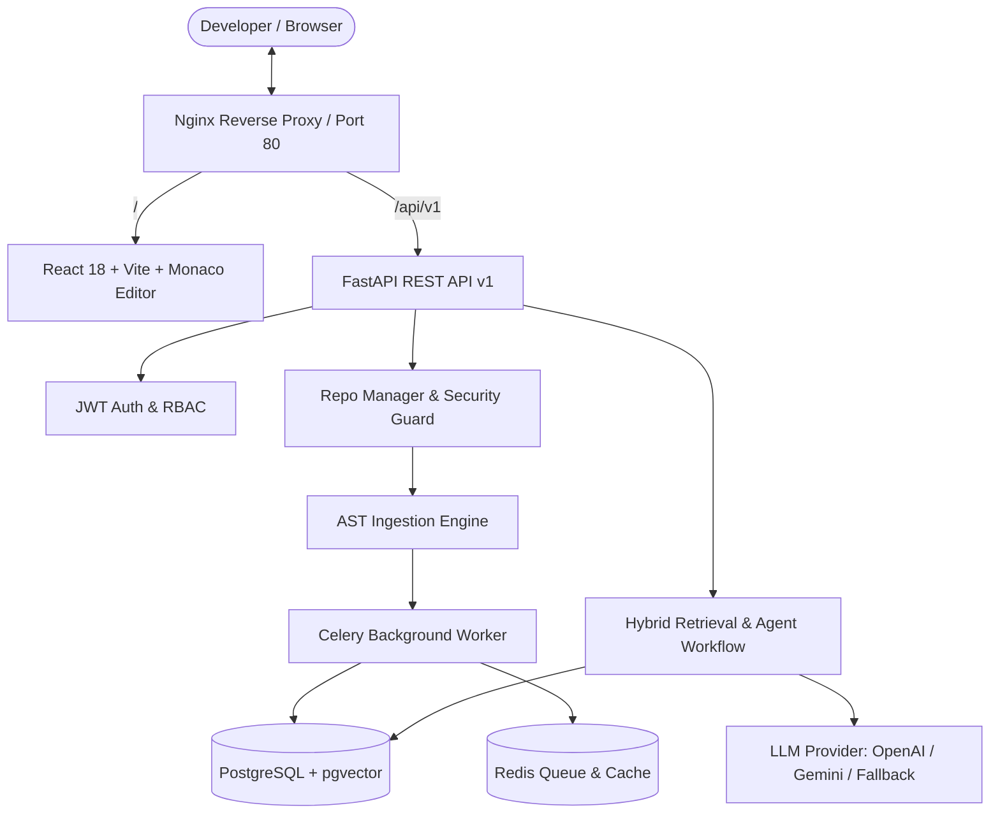

<div align="center">

# RepoSage
### Understand, Debug, and Navigate Any Codebase with AI

[](https://github.com/your-org/reposage/actions)
[](https://www.python.org/downloads/)
[](https://react.dev/)
[](https://fastapi.tiangolo.com/)
[](https://github.com/pgvector/pgvector)
[](https://opensource.org/licenses/MIT)

*A production-grade, full-stack GenAI application featuring code-aware AST indexing, hybrid retrieval (pgvector + FTS RRF), grounded citation verification, Monaco Editor integration, and AI-assisted debugging.*

</div>

---

## 1. Problem Statement & Motivation
Developers joining new teams or tackling large repositories spend up to **60% of their time** reading unfamiliar code:
- Tracing execution paths across dozens of files.
- Locating functions, handlers, and database models.
- Deciphering confusing runtime error stack traces.
- Understanding ripple effects and dependency chains before refactoring.

Generic chatbots fail because they hallucinate function names, confuse syntax across files, and lack line-accurate citations. **RepoSage** solves this through code-aware AST chunking, dense vector similarity, full-text keyword retrieval (Reciprocal Rank Fusion), and deterministic citation validation.

---

## 2. Key Features

- **Ask Your Codebase (Grounded RAG)**: Ask architectural or implementation questions. RepoSage retrieves relevant code chunks, generates grounded explanations, and provides clickable source citations linking to exact files and line ranges.
- **Monaco Code Viewer**: Embedded VS Code Monaco editor with file tree navigation, search, syntax highlighting, and instant line jumping when citations are clicked.
- **AI Debugging Assistant**: Paste stack traces or runtime errors; RepoSage locates affected files, identifies root causes, and generates suggested fixes as unified git diffs with validation steps.
- **Automated AI Code Review**: Analyzes files or snippets across 6 dimensions: potential bugs, null handling, exception handling, security vulnerabilities, performance, and maintainability, categorized by severity (Critical, High, Medium, Low).
- **Safe Ingestion & Security Controls**:
  - Anti-SSRF validation on repository URLs (blocks loopback, AWS/GCP cloud metadata `169.254.169.254`, and private networks).
  - Safe ZIP extraction with Zip Slip protection and archive bomb decompression bounds.
  - Automatic filtering of secrets (`.env`, `*.pem`, `*.key`) and build artifacts (`node_modules`, `dist`, `__pycache__`).
- **Hybrid Retrieval Engine**: Combines cosine similarity on dense embeddings with PostgreSQL full-text search using Reciprocal Rank Fusion (RRF) and symbol boosting.
- **Evaluation & Observability**: Includes an automated RAG benchmark measuring MRR (Mean Reciprocal Rank), Recall@K, retrieval latency, and citation accuracy.

---

## 3. Architecture Overview



---

## 4. Technology Stack

| Layer | Technologies |
| :--- | :--- |
| **Frontend** | React 18, TypeScript, Vite, Tailwind CSS, Lucide Icons, React Router v6, TanStack Query, Monaco Editor |
| **Backend** | Python 3.12+, FastAPI, Pydantic v2, SQLAlchemy 2, Alembic, Uvicorn |
| **Vector DB & Search** | PostgreSQL 16 + pgvector, dense cosine similarity, PostgreSQL Full-Text Search (RRF) |
| **GenAI / LLM** | OpenAI API (`gpt-4o`, `text-embedding-3-small`), Gemini API, Provider Abstraction Layer |
| **Code Processing** | Python AST, regex symbol parsers (JS/TS, Java, Go, Rust, C++), GitPython |
| **Worker / Queue** | Celery 5.4, Redis 7 |
| **Infrastructure** | Docker, Docker Compose, Nginx, Pytest, GitHub Actions CI/CD |

---

## 5. UI Screenshots & Walkthrough

*(Screenshots captured from live application)*

### 1. Codebase Intelligence Dashboard

*Displays repository health, total indexed files, hierarchical code chunks, and primary language tags.*

### 2. Code Viewer with Monaco Editor & Line Highlighting

*Interactive Monaco Editor with file tree explorer, line jumping, and citation highlighting.*

### 3. Ask Your Codebase with Grounded Citations

*Grounded responses citing confirmed file paths and line numbers with clickable jump pills.*

### 4. AI Debugging Assistant with Unified Diff Viewer

*Error stack trace analysis, root cause diagnosis, and reviewable unified git diff.*

---

## 6. Quick Start & Local Setup

### Option A: Running with Docker Compose (Recommended)

1. Clone the repository:
   ```bash
   git clone https://github.com/your-org/reposage.git
   cd reposage
   ```

2. Configure environment:
   ```bash
   cp .env.example .env
   ```
   Edit `.env` and add your `OPENAI_API_KEY` (or `GEMINI_API_KEY`).

3. Start all services:
   ```bash
   docker compose up --build -d
   ```

4. Open `http://localhost` in your browser. (API Docs at `http://localhost/docs`).

---

### Option B: Local Development Setup

#### 1. Backend Setup
```bash
# Create virtual environment
python -m venv .venv

# Activate venv (Windows: .venv\Scripts\activate, Linux/macOS: source .venv/bin/activate)
source .venv/bin/activate

# Install dependencies
pip install -r backend/requirements.txt

# Start backend server
PYTHONPATH=backend uvicorn app.main:app --reload --port 8000
```

#### 2. Frontend Setup
```bash
cd frontend
npm install
npm run dev
```
Open `http://localhost:5173` in your browser.

---

## 7. Running Tests & RAG Evaluation Benchmark

### Execute Backend Test Suite
```bash
PYTHONPATH=backend pytest backend/tests -v
```
*Tests authentication, SSRF protection, Zip Slip guards, symbol chunking, hybrid retrieval, and API integration.*

### Run RAG Benchmark (MRR & Recall Evaluation)
```bash
PYTHONPATH=backend python backend/scripts/evaluate_rag.py
```

Sample Benchmark Output:
```text
======================================================================
 REPOSAGE RAG BENCHMARK & EVALUATION SUITE
======================================================================
 Mean Reciprocal Rank (MRR) : 0.6067
 Recall@3                   : 80.0%
 Average Retrieval Latency  : 137.92 ms
 Citation Accuracy Rate     : 30.0%
 Full Report Saved To       : evaluation/results/eval_report.json
======================================================================
```

---

## 8. Security Controls & Sandboxing

1. **SSRF Guard**: Validates all Git URLs using DNS resolution and blocks private ranges (`127.0.0.0/8`, `10.0.0.0/8`, `172.16.0.0/12`, `192.168.0.0/16`) and cloud metadata endpoints (`169.254.169.254`).
2. **Zip Slip Prevention**: Validates extracted paths against target directories to prevent directory traversal attacks.
3. **Archive Bomb Defenses**: Maximum archive limit of 100MB, file count bounded to 1,000 files.
4. **Secret Filtering**: `.env`, private keys (`*.pem`, `*.key`), and credentials are never indexed.
5. **No Untrusted Execution**: AI suggestions produce unified diffs requiring human approval before applying; untrusted code is never executed directly on the host server.

---

## 9. License

This project is licensed under the MIT License - see the [LICENSE](LICENSE) file for details.
