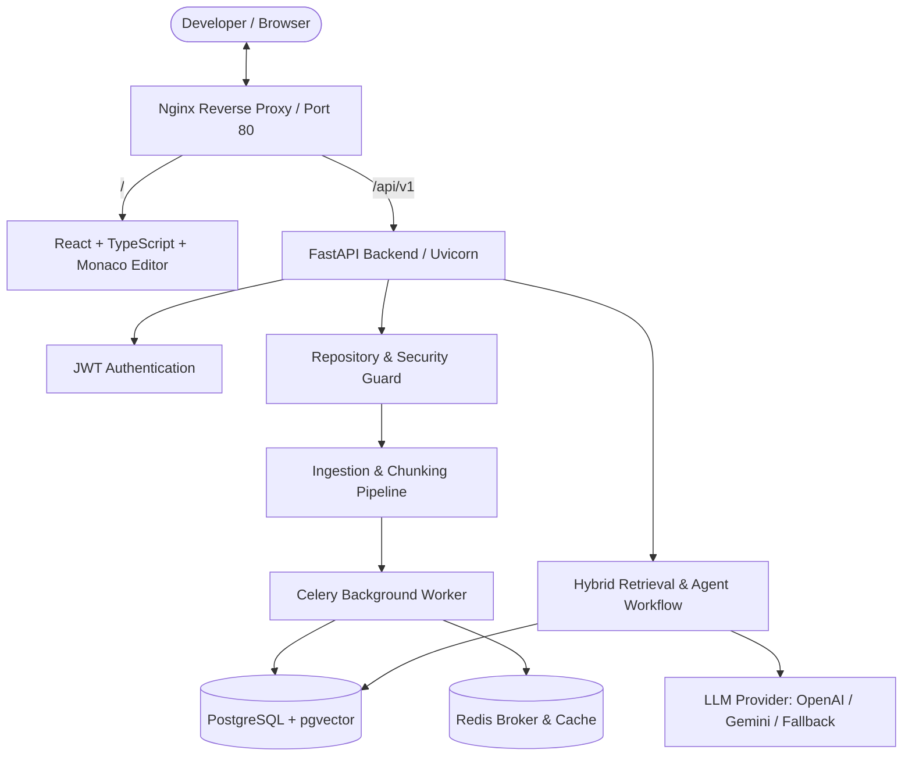
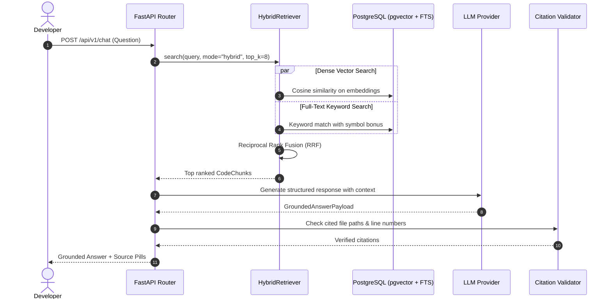

# RepoSage Architecture Document

## 1. System Philosophy
RepoSage is designed to solve a core problem in modern software engineering: understanding and navigating large, unfamiliar codebases without losing developer trust to hallucinations. To achieve this, the architecture prioritizes **code-grounded indexing**, **hybrid retrieval (dense vector + full-text RRF)**, and **deterministic citation validation**.

---

## 2. Core Subsystems

### 2.1 Repository Ingestion & Parsing Engine
The ingestion pipeline converts raw source trees into structured code chunks:
1. **Acquisition & Security**: Repositories are acquired via HTTPS Git cloning (`--depth=1`) or safe ZIP upload.
   - **Anti-SSRF**: URLs are validated to prevent targeting private IPs, AWS/GCP cloud metadata endpoints (`169.254.169.254`), or loopback interfaces.
   - **Zip Slip & Bomb Protection**: ZIP files are extracted ensuring no path leaves the workspace (`commonpath` checks) and decompressing stops if size exceeds 100MB or 1,000 files.
2. **File Filtering**: Excludes `.git`, `node_modules`, `dist`, `__pycache__`, binaries, lock files, and sensitive credentials (`.env`, `*.pem`, `*.key`).
3. **AST & Symbol Extraction**: Uses Python AST and language parsers to identify classes, methods, top-level functions, and line ranges.
4. **Code-Aware Chunking**: Chunks retain the enclosing symbol context and line boundaries rather than cutting blindly across fixed byte lengths.

---

### 2.2 Hybrid Retrieval Pipeline

---

## 3. Architectural Decisions & Trade-Offs

| Decision | Alternative Considered | Rationale & Trade-Off |
| :--- | :--- | :--- |
| **PostgreSQL + pgvector** | Pinecone / Qdrant / Milvus | Minimizes infrastructure complexity by unifying relational entities (users, repos, chat sessions) and dense embeddings in one ACID-compliant database. |
| **Code-Aware Chunks** | Fixed-size sliding text window | Fixed-size splits cut functions in half, destroying logic context. Hierarchical symbol chunking ensures each function/class retains its signature. |
| **Reciprocal Rank Fusion** | Pure vector similarity | Vector search often misses exact variable names or method identifiers. Combining full-text matching with dense embeddings guarantees both conceptual and literal recall. |
| **Monaco Editor in Frontend** | Simple `highlight.js` / `prism` | Monaco provides full VS Code syntax highlighting, line numbers, search within file, and programmatic line jumping when citations are clicked. |
