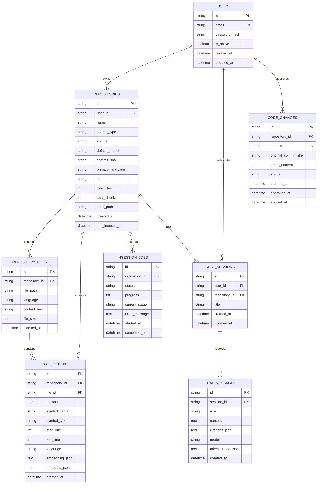

# RepoSage Database Design & Schema

RepoSage utilizes PostgreSQL 16 with the `pgvector` extension for dense embedding storage, supplemented with full-text search indexing and relational constraints.



---

## Indexing & Performance Optimizations
1. **Foreign Key Cascades**: Deleting a repository cascades cleanly down to `repository_files`, `code_chunks`, `chat_sessions`, and `ingestion_jobs`.
2. **Dense Vector Indexes**: In production PostgreSQL, `code_chunks` uses an IVFFlat or HNSW cosine similarity index:
   ```sql
   CREATE INDEX ON code_chunks USING hnsw (embedding vector_cosine_ops);
   ```
3. **Compound Lookups**: Indexes on `(repository_id, file_path)` and `(repository_id, symbol_name)` guarantee sub-millisecond symbol resolution.
